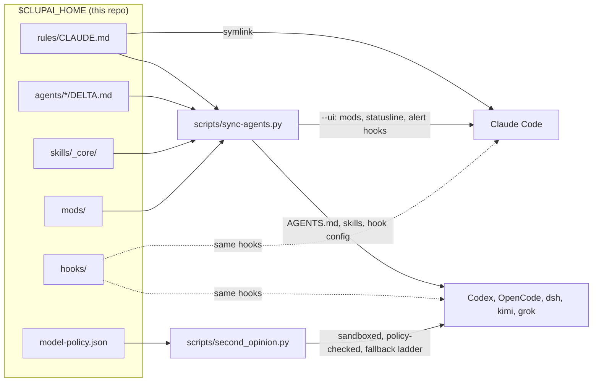

# cstack

**One shared rules, hooks and skills layer for Claude Code, Codex, OpenCode, DeepSeek, Kimi and Grok Build, tuned by measurement to spend fewer tokens.**

Hi, I'm Clupai. This is the setup I run every day, not a framework I built for other people. I usually have
several agent sessions open on the same repos at once, across two Claude accounts and a handful of other CLIs, and I
check on most of them from my phone. Without shared rules they tripped over each other's files, started duplicate
Docker stacks and burned quota on work a cheaper model could do.

So everything here does one of three jobs:

- **Keep parallel sessions out of each other's way:** file claims, turn queues, shared stacks, rules learned from failures.
- **Spend fewer tokens:** every routing rule below comes from a benchmark or bake-off I ran on my own work.
- **Let me work from my phone:** short replies with the answer first, a recap at the end, and an alert when a session needs me.

Take what's useful. Expect it to reflect my machine (macOS, kitty) and my habits; see [Limits](#limits).

## My day with it

1. I open sessions in kitty or [MonoCode](#monocode), one per task, often on the same repo.
2. Each session claims the files it edits, so two never edit one file at once; they message each other to hand over.
3. Routine coding runs on a cheap model at low effort; Codex reviews every diff before I call it done.
4. When a session finishes or needs me, I get a sound and a notification; a question left 5 minutes goes to my phone. Replies end with a `Close:` line saying if I can shut it.
5. When something breaks in a way another session could repeat, it becomes a guardrail every later session sees.

## Why it saves tokens

Measured on my own work, Sep-Oct 2026. The routing benchmark used tasks built from real work with planted bugs and defects
([docs/routing.md](docs/routing.md)); the bake-off used real commits from one app ([docs/bake-off.md](docs/bake-off.md)).

| Rule | Measured effect |
|---|---|
| Subagents run Opus at **low** effort, always pinned | Opus 5: 96-100% on every scored task, $0.33/task vs $0.90 at xhigh (2.7x), no meaningful gain. Opus 5.5 low: 10/10 app tasks for $8.22, half of high, same code quality |
| Coding a test decides goes to Sonnet 5.5 at low effort | 10/10 tasks for $4.78, 58% of Opus 5.5 low's cost (29 Sep) |
| Short, tightly briefed coding goes to Haiku 5.5 at low effort | 10/10 tasks for $1.44 (10 Oct); its price goes up 5x past a 100k-token prompt, so jobs stay short |
| One cheap model alone, no mixing | Every mix also passed 10/10; "Opus plans, a cheaper model codes" added $8-12; an Opus advisor with a reminder cost 4x ($3.10 to $12.84) |
| No "cheap model works, Opus reviews" | $0.78 vs $0.33 for Opus low alone, same score |
| Reviews go outside Claude, on the diff only | Almost no Claude usage. In Sep 2026, 302 Codex reviews used 267M input tokens (median 553k each); `--review` sends the diff so the reviewer stops exploring the repo |
| Bulk coding on DeepSeek V4 Flash, then a review pass | 10/10 tasks for ~$1.50 vs $20.60 on Opus 5 |
| Reset context near 200k | A call at 600-900k costs ~3x a call at 200k (estimate: $0.38 vs $0.13) |
| Auto-compact at 250k; agents reset themselves at break points | 59% of one week's Claude spend was on calls past 200k context |
| Do lookups inline, not in an agent | Every agent pays setup tokens first (estimate: 30-50k) |
| Skills load on demand, not all installed | The skill listing cost tokens in every agent (estimate: ~7.5k before cleanup) |
| Memories recalled per prompt, not preloaded | `MEMORY.md` shrinks to pinned notes; the rest arrives when relevant |

## How it fits together



More: [docs/architecture.md](docs/architecture.md), and per agent (rules, skills, hooks, quirks): [docs/agents.md](docs/agents.md).

## What each hook does

| Hook | One line |
|---|---|
| `hooks/claims.py` | Claims each file a session edits; blocks two sessions editing one file in one worktree; keeps status notes and history; `closeout` lists what a session still holds |
| `hooks/queues.py` | Gives one session at a time a turn on a shared target, like a staging deploy or a merge |
| `hooks/guardrails.py` | Rules learned from failures (warn, stop, queue, deny) that every later session gets |
| `hooks/memory_guard.py` | Blocks new agents and heavy commands when the Mac is low on memory |
| `hooks/memory_recall.py` | Adds only the memories that match the prompt, from every account |
| `hooks/effort_gate.py` | Makes the model state the effort a task needs, and ask you to change it early in a session |
| `hooks/agent_hook.py` | Lets Codex, OpenCode, dsh, kimi and Grok Build run the same hooks as Claude Code |
| `hooks/codex_hook.py` | Shim to `agent_hook.py` for Codex |
| `hooks/stacks.py` | Shares one Docker stack, simulator or emulator between sessions by lease; a reaper stops the ones nobody uses |
| `hooks/reset.py` | Lets a long-running session clear or compact its own context at a break point (kitty only) |
| `hooks/alerts.py` | A sound and notification when a session finishes or needs you; a question left 5 min gets `/remote-control` typed so it reaches the phone app |
| `hooks/session_mirror.py` | Mirrors session entries between Claude accounts so they can message each other |

## Mods

Mods are Claude Code plugins (panes, bands, tools) in `mods/<name>/`.

- `sync-agents.py --ui` (or `--only ui`) puts every mod folder with a `.claude-plugin/plugin.json` into
  `CLAUDE_CODE_PLUGIN_DIRS` in each Claude account's `settings.json`, so every session loads it.
- A mod folder holding an `OPT-IN` file is skipped; load it per session with `claude --plugin-dir <path>`.
- `mods/side-checklist`: a checklist pane beside the session. When the model gives you steps to carry out, it also
  puts them on the pane with its `checklist` tool; you tick them off there and the model is told. `/checklist` opens it.

## Scheduled jobs (launchd)

| Job | Every | Runs |
|---|---|---|
| `com.example.session-mirror` | 15 s | `hooks/session_mirror.py sync`: lets sessions in different Claude accounts message each other |
| `com.example.stacks-reaper` | 10 min | `hooks/stacks.py reap`: stops Docker stacks, simulators and dev servers nobody leases |
| `com.example.claude-usage-report` | Saturday 09:00 | `scripts/usage_report.py --write`: one row of weekly spend in `claude-usage.md` |

Templates are in `examples/launchd/`. Install one (replace `NAME`):

```bash
sed -e "s|__CLUPAI_HOME__|$CLUPAI_HOME|g" -e "s|__PYTHON__|$(command -v python3)|g" -e "s|__HOME__|$HOME|g" \
  examples/launchd/com.example.NAME.plist > ~/Library/LaunchAgents/com.example.NAME.plist
launchctl bootstrap gui/$(id -u) ~/Library/LaunchAgents/com.example.NAME.plist
```

## MonoCode

[MonoCode](https://github.com/hardbeat920/monocode) (MIT) is a desktop GUI for coding agents: each tab is a session
of a CLI you already have. I run a fork, [Clupai8o0/monocode](https://github.com/Clupai8o0/monocode),
branch `mine`, that reads this layer: claims tags on files (`claims.py list --json`), a stacks panel
(`stacks.py list --json`), close badges from a reply's `Close:` line (the on-the-go output style writes one), peer-message cards, a re-alert after 5 min,
and "ring at my places", which `hooks/alerts.py` follows. Details: [docs/monocode.md](docs/monocode.md).

## Docs

| Doc | What |
|---|---|
| [docs/architecture.md](docs/architecture.md) | How the layer fits together, shared state, design choices |
| [docs/agents.md](docs/agents.md) | One row per agent CLI: how it gets rules, skills and hooks, what it is for, its quirks |
| [docs/token-economy.md](docs/token-economy.md) | The measured rules for spending fewer tokens, including context size |
| [docs/routing.md](docs/routing.md) | Model routing benchmark (17 Sep 2026) |
| [docs/bake-off.md](docs/bake-off.md) | Bake-off on real commits, and the current role per model |
| [docs/tool-trials.md](docs/tool-trials.md) | Workflow tools tried, the verdict on each, and where the keepers are used |
| [docs/monocode.md](docs/monocode.md) | The MonoCode fork: what it reads from this layer, how it updates itself |
| [docs/roadmap.md](docs/roadmap.md) | What is planned next |

## What else is here

| Path | What |
|---|---|
| `rules/CLAUDE.md` | Global rules template: claims, queues, guardrails, memory, token economy, second-model review, short documents, close lines |
| `skills/_core/token-economy` | Picks model, effort and route for every subagent and second opinion |
| `skills/_core/tool-scoping` | Puts skills, MCP servers and keys only where they are used |
| `skills/production-ready` | Audits an app, API, site, mobile app or CLI against a 3-tier production checklist (16 areas) and ranks the gaps |
| `skills/production-ready/security-lists.md` | Security bug-list sweep: OWASP Top 10, API, MASVS, LLM and ASVS, CWE Top 25 and MITRE ATT&CK, turned into checks |
| `skills/_core/vault-skills` | Loads a library skill on demand. The repo ships `_core` and `production-ready`; the rest of the library (`skills/<category>/`) is yours to add |
| `hooks/alerts.py` | Session alerts (above); settings in an optional `alerts.json`, defaults in `examples/alerts.example.json` |
| `mods/` | Claude Code plugins every account loads; ships `side-checklist` (above) |
| `scripts/second_opinion.py` | Calls outside models through one sandboxed, policy-checked fallback ladder; `--review` sends only the git diff |
| `scripts/sync-agents.py` | Generates each agent's `AGENTS.md` and links skills and hooks |
| `scripts/build_index.py` | Rebuilds `skills/INDEX.md` |
| `output-styles/on-the-go.md` | Replies for reading on a phone: answer first, decisions as a checklist, recap at the end |
| `ui/` | Shared statusline and palette |
| `bakeoff/` | Generic harness to run your own model bake-off on your repo's history |
| `examples/` | `model-policy`, `guardrails`, `stacks`, `alerts` and Claude `settings` hooks to start from; `launchd/` jobs (above) |
| `tools/export.py` | How this repo is refreshed from the private copy, with a leak scan |
| `.sync-agents-skip` | Put this empty file in a folder so `sync-agents.py --repos` never links an `AGENTS.md` there (`rules/` has one) |

## Quick start

```bash
git clone <this repo> ~/clupai
cd ~/clupai
./install.sh                       # prints the plan, changes nothing
./install.sh --yes --settings      # links rules, skills, output style; merges hooks into ~/.claude/settings.json
export CLUPAI_HOME=~/clupai        # add to your shell profile
```

- **This replaces `~/.claude/CLAUDE.md`** with a link to `rules/CLAUDE.md`. The old file is backed up next to it.
- To keep your own file instead: `./install.sh --yes --no-rules`, then add the line `@~/clupai/rules/CLAUDE.md` to it.
- Edit `model-policy.json` so your folders get the right policy. Unlisted folders are confidential.
- `--settings` also merges the `reset.py` and `alerts.py` hooks. Copy `examples/stacks.example.json` and
  `examples/alerts.example.json` by hand if you want them.
- Mods, the shared statusline and the 250k auto-compact window: `python3 scripts/sync-agents.py --only ui --check`,
  then run it again without `--check`. `install.sh` never sets these.
- Other agents: install their CLIs, then `./install.sh --yes --agents`. It only runs `sync-agents.py --check` and
  prints the command to apply it.
- Codex will not run a new `hooks.json` until you open `codex` once interactively and approve it.
- More than one Claude account: `CLAUDE_DIRS="$HOME/.claude $HOME/.claude-exec" ./install.sh --yes`.

## Model routing

| Model | Route | Role |
|---|---|---|
| Opus 5.5 | Claude Code | Main worker at low effort; high effort for text people read, reviews and final judging. Opus 5 is the fallback |
| Fable 5.1 | Claude Code | Hardest coding tasks only; not a reviewer |
| Sonnet 5.5 | Claude Code, low effort | Coding where a test or script decides pass/fail; never reviews or prose |
| Haiku 5.5 | Claude Code, low effort | Short, tightly briefed coding a test decides, and cheap extra review passes, on any folder; not a main reviewer |
| GPT-6 Astra | `codex` | Reviews every code change (the diff); one of the review trio |
| GPT-6.1 Sol | `codex:gpt-6.1-sol` | Codes on personal and open folders when Claude quota is tight; not a reviewer |
| DeepSeek V4 Flash | `dsh:deepseek-flash` | Default bulk worker and reviewer; always follow its code with a review; never for factual prose |
| Gemini 3.8 Flash | `agy:gemini-3.8-flash-high` | Free quick drafts and reads (plan quota) |
| Grok 4.7 (Grok Build) | `grok:grok-4.7` | Extra reviewer on personal folders, and the stand-in when Codex is out of quota; Grok plan quota |
| Kimi K3 | `kimi:kimi-k3` | Backup if DeepSeek is down |

Dropped: DeepSeek V4 Pro, OpenCode Go and Zen, Haiku 4.5. GLM-5.3, Grok 4.6 and MiniMax M3 run through OpenRouter
for second opinions only.

Bake-off in one line each (10 real tasks from a production React Native + Firebase app, 5 review cases with 17 real bugs):

- Every top model passed 10/10, so speed, cost and code quality decided.
- DeepSeek V4 Flash: 10/10 for ~$1.50 and 9 of 17 review bugs (level with Opus 5.5 high), but 34-54% more defects than Claude.
- Opus 5.5 (23 Sep): 10/10 for $16.12, 22% less than Opus 5, and found 8-10 of 17 review bugs vs Fable 5.1's 4-6 at ~37% of the cost.
- Fable 5.1 wrote the cleanest code in the first blind review, so it keeps the hardest coding tasks only.
- Sonnet 5.5 low (29 Sep): 10/10 for $4.78; at high effort it found only 6 of 17 in review, and at low it invents cause-and-effect links in prose.
- Haiku 5.5 low (10 Oct): 10/10 for $1.44, but slow on long tasks (30 min where Sonnet took 8).
- GPT-6.1 Sol (11 Oct): the cleanest code measured, but only 3 of 17 in review.
- Mixed setups (10-11 Oct): all passed 10/10; an Opus lead directing a cheap coder was fastest (26-30 min) and no better.
- Gemini 4 Argon (14 Oct): 10/10 coding and 10 and 8 of 17 in review, at about twice Opus 5.5 high's price per review; routing not changed.
- Grok Build: 10/10 coding, 2 of 3 bugs on the one review case run. Grok 4.7 via OpenRouter found 7 of 17.
- Review trio now: DeepSeek Flash + Opus 5.5 + GPT-6 Astra (before 23 Sep, Fable held Opus 5.5's seat).
- Every model missed most security-rules bugs. Those still need a human.

## Code review

Every code change gets a Codex review of the diff before it counts as done.

- Command: `second_opinion.py - --cwd <repo> --review [--base BASE] --ladder codex` (the diff goes in the prompt with a findings-only brief).
- Medium effort by default; `--codex-effort high` for client work and risky changes (auth, security, database rules,
  payments, migrations or deletes, concurrency, a diff over ~300 lines).
- Extra passes: DeepSeek V4 Flash on open and personal folders, plus Grok 4.7 on personal ones.
- Codex out of quota: Grok 4.7 on personal folders; on confidential ones an Opus 5.5 review subagent at high effort.

## Limits

- **macOS first.** The outside-model sandbox uses `sandbox-exec`; the memory guard reads macOS stats; alerts use
  macOS sounds and kitty notifications.
- **One person's data: mine.** The routing benchmark ran 2 runs per setup; the bake-off ran each task once per model, on one app.
  Run `bakeoff/` on yours.
- **Model names and prices age fast.** All numbers are from Sep-Oct 2026. Codex ran gpt-5.6-sol in the routing
  benchmark and GPT-6 Astra in the bake-off.
- **Hooks fail open.** A broken script never blocks work, so check `claims.py list` works after install.
- **`sync-agents.py` edits other tools' config** (Codex `hooks.json` and `config.toml`, kimi and grok `config.toml`,
  dsh profiles). Backups are timestamped and never overwritten. Claude settings (statusline, theme, env for
  auto-compact and mods, reset and alert hooks) and Codex `[tui]` change only with `--ui`, and repo `AGENTS.md`
  links only with `--repos`, at a repo's git top level. Run `--check` first.
- **`--ui` writes Claude settings to `~/.claude` and `~/.claude-exec` only**; it does not read `CLAUDE_DIRS`. It also
  regenerates `ui/palette.json` and sets Codex `[tui]`.
- **Outside models may keep or train on what you send.** That is what `model-policy.json` is for.
- **The `ui/` palette follows a kitty accent file** if you have one; otherwise it uses the default.

## Third-party skills I use alongside (not included)

| Skills | Upstream |
|---|---|
| docx, pdf, pptx, xlsx, skill-creator, mcp-builder, canvas-design, theme-factory, algorithmic-art | [anthropics/skills](https://github.com/anthropics/skills) |
| brainstorming, systematic-debugging, test-driven-development, using-git-worktrees, subagent-driven-development | [obra/superpowers](https://github.com/obra/superpowers) |
| context-compression, context-degradation, memory-systems, multi-agent-patterns, tool-design | [muratcankoylan/Agent-Skills-for-Context-Engineering](https://github.com/muratcankoylan/Agent-Skills-for-Context-Engineering) |
| mem-search, make-plan, smart-explore | [thedotmack/claude-mem](https://github.com/thedotmack/claude-mem) |
| vercel-react-best-practices, web-design-guidelines | [vercel-labs/agent-skills](https://github.com/vercel-labs/agent-skills) |

## License

MIT, Clupai. See [LICENSE](LICENSE).
